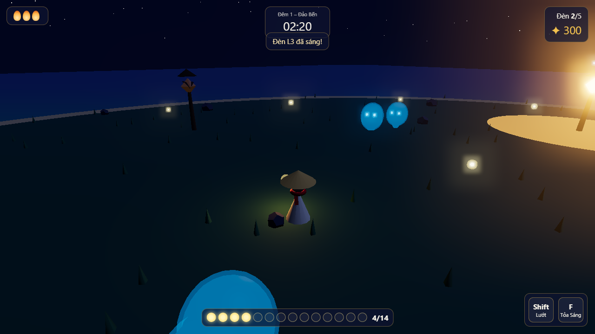
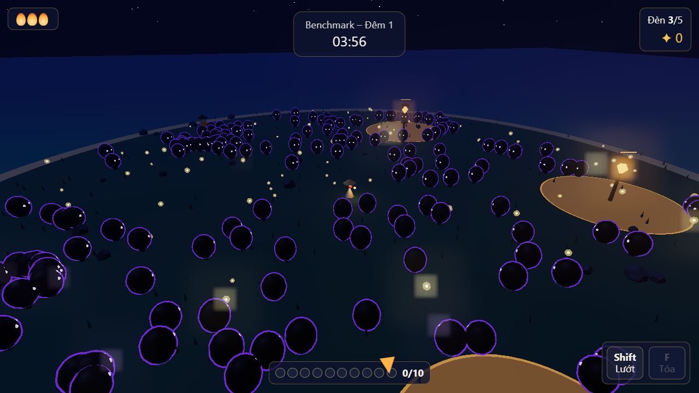

# Đảo Đèn Lồng — v1.0.0

> **Video demo:** đính kèm ở [Release v1.0.0](../../releases/tag/v1.0.0) (`demo.mp4`, dưới 5 phút).
> Nguyễn Tiến Hưng · 2A202603365 · K5 L3A · Day 12 AI SDLC · Tài liệu gốc của lab: [docs/lab/](docs/lab/README.md)

Game 3D góc nhìn thứ ba. Bạn là **Mây**, người giữ đèn nhỏ tuổi đội nón lá, áo trắng ngà, khăn đỏ. Sương đen đã nuốt ánh sáng của ba hòn đảo. Hãy gom **đom đóm**, thắp và **giữ các Đèn Lồng Lớn còn sáng tới bình minh**, né **Bóng Mực** (chúng hút dầu đèn yếu) và đừng để **Gió Lạc** cướp đom đóm.




## Yêu cầu hệ thống
| Mục đích | Cần |
|---|---|
| Chơi | Node.js **≥ 18**, trình duyệt có WebGL2 (Chrome/Edge/Firefox/Safari mới), macOS / Linux / Windows |
| Test, headless, soak | Node.js ≥ 18 (không cần trình duyệt, không cần `npm install`) |
| Benchmark | Node.js **≥ 22** (WebSocket có sẵn) + Chrome / Chromium / Edge (đặt `CHROME=/đường/dẫn` nếu ở chỗ lạ) |

## Cài đặt và chạy (3 lệnh)
```bash
git clone https://github.com/tienhungw/K5-L3A-DAY12-NguyenTienHung-2A202603365-AI-SDLC-Dao-Den-Long.git dao-den-long && cd dao-den-long
npm install
npm start          # mở http://localhost:8765  (cổng bận? PORT=8766 npm start)
```
Bản chạy sẵn không cần `npm install`: tải `dao-den-long-v1.0.0.zip` ở Release v1.0.0, giải nén, chạy `node server.js`.

## Điều khiển (đổi được trong Cài đặt)
| Phím mặc định | Hành động |
|---|---|
| W A S D | Di chuyển theo hướng camera |
| Kéo chuột / ← → | Xoay camera |
| Space | Nhảy |
| Shift | Lướt (14 m/s trong 0.2 s, hồi chiêu 1.5 s) |
| E | Nạp ánh sáng / châm dầu cho Đèn Lồng Lớn gần nhất (trong 2 m) |
| F | Tỏa Sáng (tốn 3 đom đóm): choáng + đẩy lùi Bóng Mực trong 5 m, đuổi Gió Lạc |
| Esc | Tạm dừng: Tiếp tục · Chơi lại Đêm · Cài đặt · Về menu |

**Cài đặt** (được lưu): âm lượng, độ nhạy chuột, đổi phím (phát hiện phím trùng, nút *Khôi phục mặc định*), bảng màu mù màu, giảm chuyển động (tắt rung camera và chớp màn hình), chữ lớn ×1.25, phụ đề / chỉ báo hình ảnh (Bóng Mực xuất hiện kèm mũi tên ở mép màn hình, gió sắp thổi, 10 s cuối, đèn sắp cạn dầu). Chữ UI tối thiểu 18 px.

## Luật
- **Ba Đêm:** Đảo Bến (5 đèn, 4:00, cần giữ ≥ 3) → Đảo Cau (6 đèn, 4:30, ≥ 4; cầu tre, bục nhảy, Gió Lạc, Bùa Gió) → Đảo Chuông (7 đèn, 5:00, ≥ 5; 3 tầng, dốc, tháp chuông, gió mạnh). Thắng Đêm 3 → màn **Bình Minh**.
- Đom đóm tự nhặt khi tới gần (≤ 1 m). Sức chứa 10 + 2 × số lần thắp thành công (tối đa 20).
- Đèn mới cần 10 đom đóm, thắp lại cần 5. Đèn sáng hao **1 dầu/giây** (đầy 100). Bấm E ở đèn đang sáng để châm dầu: +10 dầu mỗi đom đóm.
- Đèn có ≥ 30 dầu tạo vùng an toàn 6 m. Dưới 30, đèn nhấp nháy, mất vùng an toàn, và Bóng Mực tới hút dầu (5/giây).
- Bóng Mực (4 m/s, Đêm 3: 4.5 m/s) phát hiện Mây trong 12 m. Chạm vào: −1 Ngọn Lửa (có 3), rơi nửa số đom đóm đang mang. Rơi xuống biển mây: −1 lửa, mất hết đom đóm.
- **Thắng:** còn sống lúc bình minh và còn ≥ 60% số đèn đang sáng. **Thua:** hết Ngọn Lửa, hoặc thiếu đèn sáng lúc bình minh.

| Điểm | |
|---|---|
| Mỗi đom đóm nạp (thắp, thắp lại, châm dầu) | +5 |
| Thắp lần đầu / thắp lại | +100 / +40 |
| Bóng Mực trúng Tỏa Sáng (đang hút dầu) | +5 (+15) |
| Bình minh (khi thắng): mỗi đèn sáng / mỗi Ngọn Lửa | +50 + phần nguyên của dầu / +50 |

**Bảng xếp hạng:** sau màn Bình Minh hoặc khi thua, nhập tên (3–12 ký tự: chữ, số, `_`, có thể gõ tiếng Việt có dấu). Bảng giữ top 10, lưu ở `data/leaderboard.json` và còn nguyên sau khi tắt game. Xem từ menu chính.

## Kiểm thử, headless, benchmark, soak
```bash
npm test                                   # 80 test: contract v1.0–v1.3, luật, 28 scenario headless (chạy 2 lần, so tất định), soak, bảng xếp hạng
node src/headless.js --seed 1 --night 1 --ticks 14400 --out out.jsonl [--scenario s.json] [--inputs i.json] [--snapshot-every 10]
node scripts/bench.mjs --seed 42 --duration 30 --out bench.json     # mở cửa sổ Chrome 1280x720
node --expose-gc --jitless --max-semi-space-size=1 src/soak.js --seed 7 --nights 10 --out soak.json
node server.js --export-leaderboard out.json                        # {"entries": [...]} theo thứ hạng
```
- **Contract:** [game.contract.json](game.contract.json) (v1.3). Game đọc trực tiếp khối `tuning` từ file này.
- **Bench:** tắt vsync bằng cờ Chrome `--disable-gpu-vsync --disable-frame-rate-limit`. `peak_mem_mb` là tổng RSS (Windows: working set) của mọi tiến trình Chrome (browser, GPU, renderer), lấy mẫu mỗi 5 s. `load_ms` tính từ lúc tiến trình `node` bắt đầu (gồm cả khởi động server và Chrome) tới khung hình đầu tiên của cảnh bench.
- **Soak:** cờ V8 `--jitless --max-semi-space-size=1` để RSS phản ánh dữ liệu thật. Không có hai cờ này, RSS tăng khoảng 25% do code JIT và vùng nhớ trẻ của V8 nở ra, trong khi `heapUsed` sau GC gần như không đổi (đã đo: 4.22 → 4.80 MB sau 150 Đêm, tức không rò rỉ). `soak.json` ghi cả `heap_used_*_mb`.
- Kết quả tự đo: [bench.json](docs/proof/phase-4/bench.json) · [soak.json](docs/proof/phase-4/soak.json) · bằng chứng mọi phase: [docs/proof/](docs/proof/README.md). CI (GitHub Actions) chạy `npm test` trên Ubuntu + macOS với Node 18 và 22.

## Sáng tạo của tôi
Tất cả nằm trong `src/web/`, chỉ là hiển thị và âm thanh, không đổi luật, nên đầu ra headless không đổi. Toàn bộ test headless chạy không cần trình duyệt và vẫn PASS. Cảnh bench không dùng bot, không phát âm thanh, và không có thực thể thêm.
- **Âm thanh riêng:** nhạc nền `lab11nen.mp3`, tiếng Tỏa Sáng `lab11duoi.mp3`, tiếng nạp ánh sáng `lab11sang.mp3` (xem CREDITS). Các hiệu ứng khác được tổng hợp bằng WebAudio.
- Vòng tiến độ trên đèn, thanh dầu, tia hút dầu của Bóng Mực, Gió Lạc là dải lụa bay theo vệt, lá bay báo gió, lời Ông Đăng cho từng Đêm, thông báo theo tình huống.
- **Bot `?autoplay&seed=5&night=1`:** dùng đúng input của contract. Bot đi qua cầu, lên dốc, dùng bục nhảy, né Bóng Mực, châm dầu. Dùng để chụp ảnh bằng chứng, đo FPS và quay demo.

## Cấu trúc
```
game.contract.json     contract v1.3 (+ bench_cmd, soak_cmd)
src/sim/               logic game thuần: world.js (luật theo từng bước/tick), maps.js, files.js, runner.js, rng.js
src/headless.js        CLI headless · src/soak.js soak test · src/leaderboard.js · src/bench-stats.js
src/web/               renderer Three.js, menu/HUD/cài đặt/bảng xếp hạng, audio.js + sounds/, autopilot.js
server.js              server tĩnh + API bảng xếp hạng + --export-leaderboard
scripts/               bench.mjs, browser-check.mjs, proof.mjs, package.mjs, gen-win-scenario.mjs, stop-hook.mjs
tests/                 node:test + tests/scenarios/*.json
docs/specs/ (ticket từng phase) · docs/adr/ (quyết định thiết kế) · docs/notes/ (giả định, nhật ký AI, retro) · docs/proof/ (bằng chứng)
AGENTS.md, CLAUDE.md, .claude/   harness AI (skill verify, Stop hook)
```

## Harness AI
[AGENTS.md](AGENTS.md) (lệnh, cấu trúc, quy tắc; cập nhật qua 4 phase) · skill [verify](.claude/skills/verify/SKILL.md) · Stop hook [.claude/settings.json](.claude/settings.json) → [scripts/stop-hook.mjs](scripts/stop-hook.mjs) (không cho agent kết thúc khi test đỏ) · CI [.github/workflows/ci.yml](.github/workflows/ci.yml). Nhật ký: [docs/notes/ai-log.md](docs/notes/ai-log.md) · Retro: [docs/notes/retro.md](docs/notes/retro.md).

Giấy phép: [MIT](LICENSE) · Nguồn: [CREDITS.md](CREDITS.md) · Thay đổi: [CHANGELOG.md](CHANGELOG.md)
