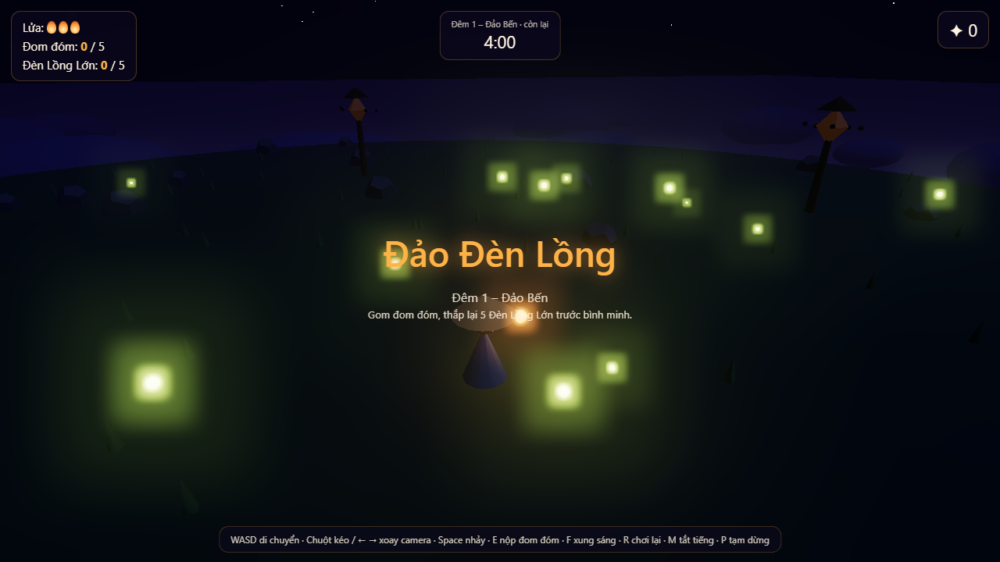
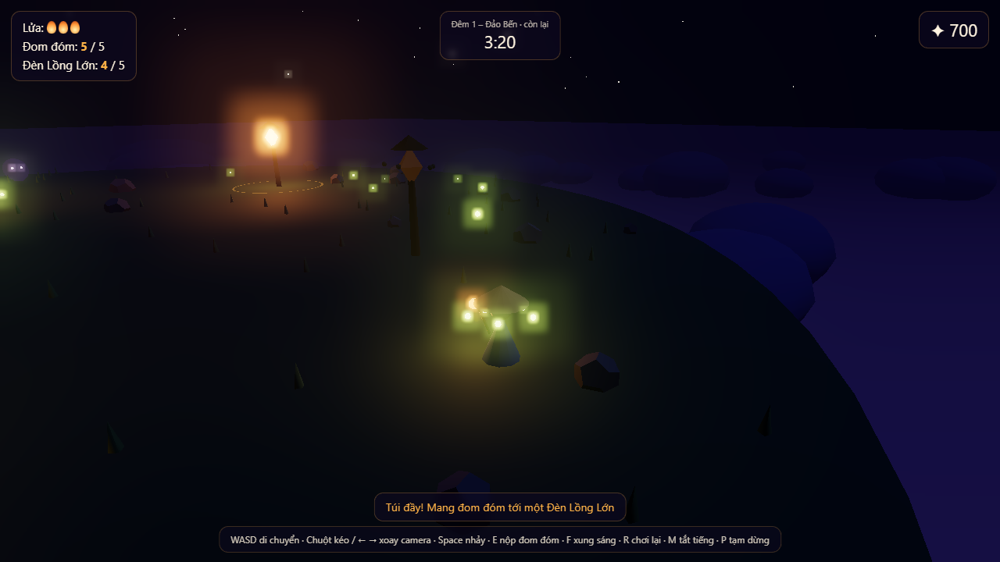
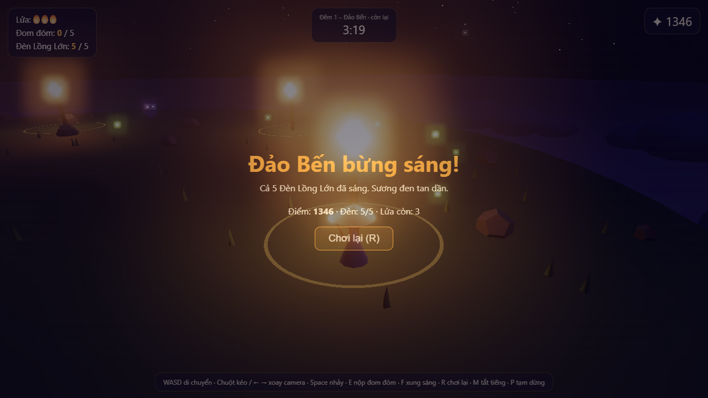

# Bằng chứng Phase 1 (tag `phase-1`)

Chạy lại toàn bộ: `npm test` (36 test: contract + gameplay + mọi scenario chạy 2 lần qua CLI thật).
Sinh lại file trong thư mục này: `node scripts/proof.mjs phase-1` (không sửa tay).

## Truy vết yêu cầu → bằng chứng
| Yêu cầu (PRD-0 / Contract) | Cách kiểm chứng | Bằng chứng | Kết quả |
|---|---|---|---|
| Di chuyển theo camera, tốc độ, chuẩn hóa vector | unit test + scenario | `tests/gameplay.test.js` (3 test), [p1-01](p1-01-move-camera.jsonl) | Đạt |
| Nhảy | unit test | `jump goes up and lands back on y = 0` | Đạt |
| Không rơi khỏi đảo (`fall_enabled: false`) | unit test | `player cannot leave the island` | Đạt |
| Nhặt đom đóm (bán kính, sức chứa, điểm) | unit test + scenario | 3 test, [p1-02](p1-02-collect-deposit.jsonl) | Đạt |
| Nộp / thắp đèn / chỉ nộp phần thiếu / nút cạnh lên | unit test + scenario | 4 test, [p1-02](p1-02-collect-deposit.jsonl) | Đạt |
| Thắng khi thắp 5 đèn, điểm đúng công thức | scenario trọn ván (điểm dự đoán độc lập 1334) | [p1-03](p1-03-full-win.jsonl), `scripts/gen-win-scenario.mjs` | Đạt |
| Bóng Mực đuổi, chạm mất lửa, rơi đom đóm, bất tử | unit test + scenario | 2 test, [p1-04](p1-04-shade-lose.jsonl) | Đạt |
| Thua khi hết lửa / hết đêm | unit test + scenario | [p1-04](p1-04-shade-lose.jsonl), [p1-05](p1-05-dawn.jsonl) | Đạt |
| Xung sáng: chi phí, choáng, đẩy, điểm, cooldown | unit test + scenario | 3 test, [p1-06](p1-06-pulse.jsonl) | Đạt |
| Bóng sợ đèn (safe_radius) | unit test + scenario 1800 tick | [p1-07](p1-07-safe-lantern.jsonl) | Đạt |
| Spawn ngẫu nhiên tất định, `shade_spawned` id mới | scenario 4800 tick | [p1-08](p1-08-default-night.jsonl) | Đạt |
| Định dạng JSONL, snapshot, làm tròn, dòng `end`, tick model | contract test | `tests/contract.test.js` (11 test) | Đạt |
| Tất định | chạy 2 lần so từng byte; khác seed → khác | contract test + mọi scenario | Đạt |
| Input/scenario hỏng → exit 2 | 10 file hỏng | contract test + [p1-09](SUMMARY.md) | Đạt |
| Chơi được: HUD, thắng/thua, chơi lại | ảnh chụp build thật (Chrome headless, bot autoplay dùng input contract) | ảnh dưới đây | Đạt |
| Video demo | — | — | **Chưa làm** (Phase 4) |

Tóm tắt máy + thời gian chạy từng scenario: [SUMMARY.md](SUMMARY.md).

## Hiệu năng headless (máy dev: Intel i5-1135G7, 8 luồng, 7.7 GB RAM, Windows 11, Node 22.20)
| Lệnh | Thời gian |
|---|---|
| `node src/headless.js --seed {1,2,3} --night 1 --ticks 4800 --out ...` (thế giới mặc định, kết thúc sớm vì đứng yên) | 0.10–0.12 s |
| trọn đêm 14 400 tick, snapshot **mỗi tick** (14 406 dòng) | 1.26 s |

## Ảnh chụp (`http://localhost:8765/?autoplay&seed=5&skip=N`)
| Ảnh | Chứng minh |
|---|---|
|  | Màn mở đầu "Đêm 1 – Đảo Bến", HUD (lửa, đom đóm, đèn, thời gian, điểm), Mây đội nón + đèn nhỏ, đom đóm phát sáng |
|  | Giữa ván (40 s): 4/5 đèn sáng, vòng an toàn quanh đèn, túi đầy 5/5 + gợi ý ngữ cảnh, Bóng Mực mắt tím bên trái |
|  | Thắng: "Đảo Bến bừng sáng!", điểm 1346, nút Chơi lại (R) |
