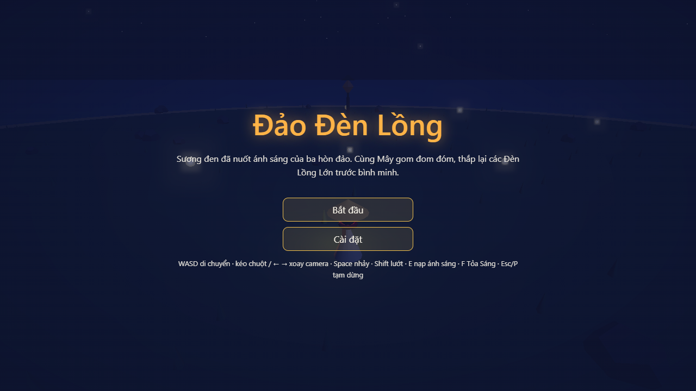
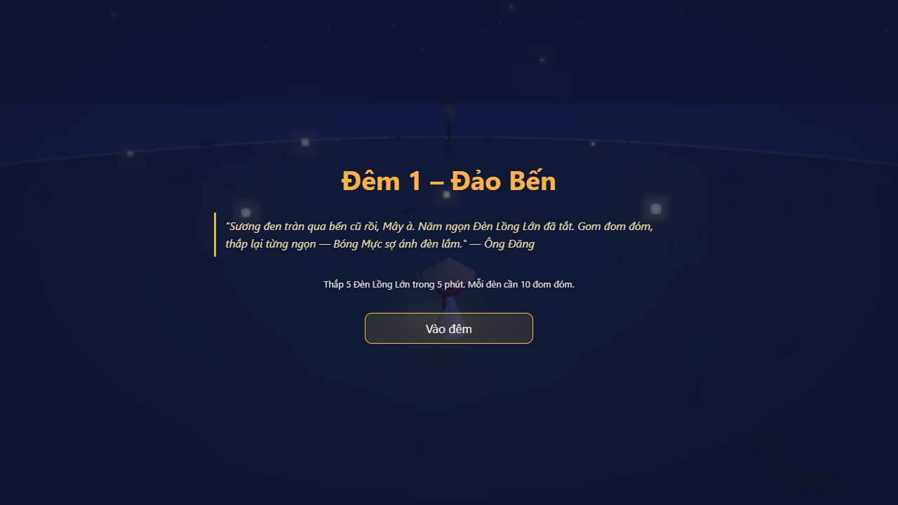
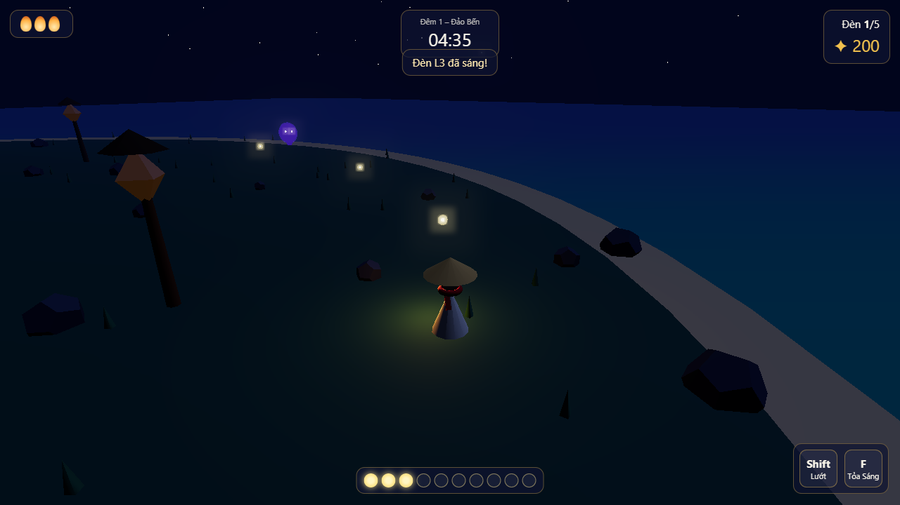
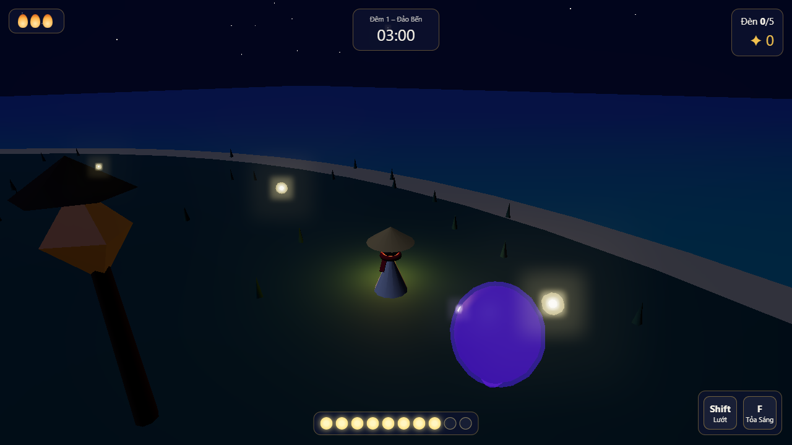
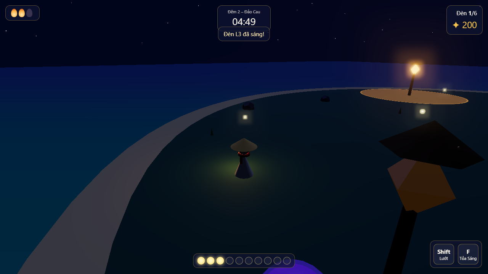
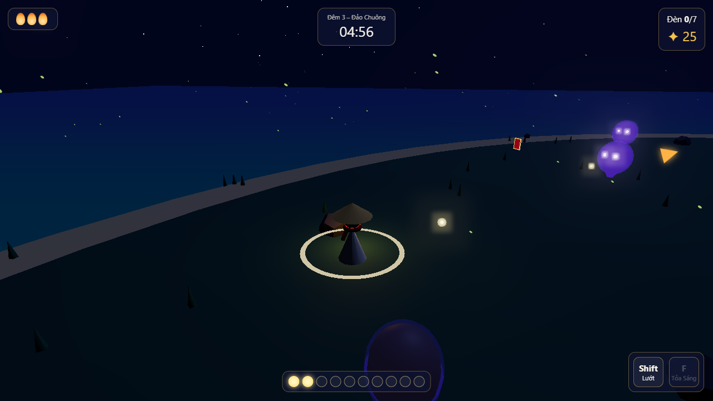
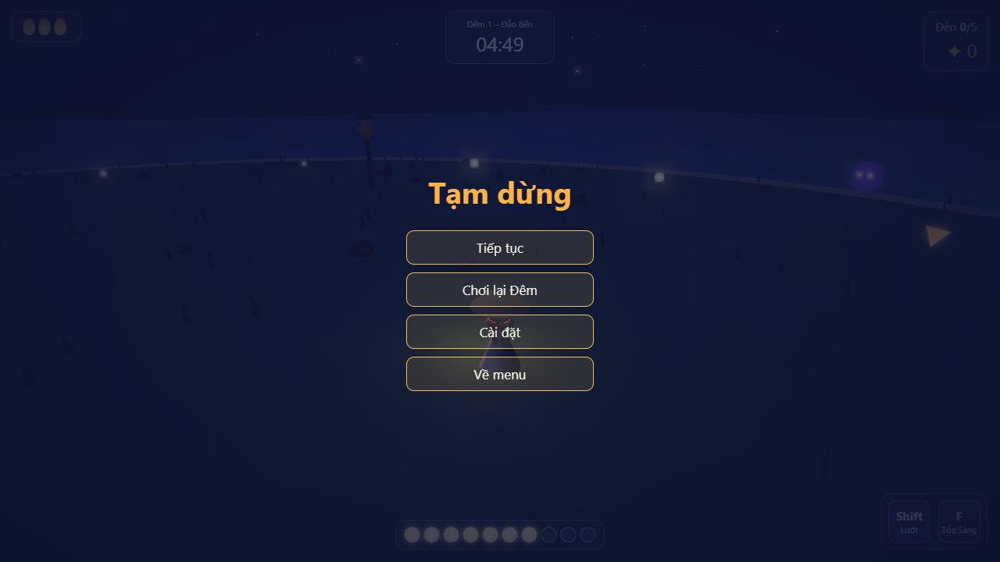
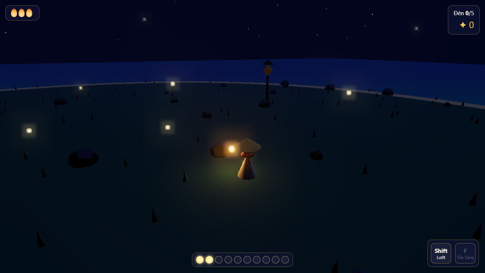

# Bằng chứng Phase 2 (tag `phase-2`)

Chạy lại: `npm test` (60 test: contract v1.1 + luật lõi theo số chuẩn + tính năng Phase 2 + 20 scenario qua CLI thật, mỗi scenario chạy 2 lần để so tất định).
Sinh lại thư mục này: `node scripts/proof.mjs phase-2` và `node scripts/browser-check.mjs docs/proof/phase-2/browser` (cần `npm start` đang chạy, Node ≥ 22 + Chrome).

## Truy vết yêu cầu → bằng chứng
| Yêu cầu Ticket-02 | Kiểm chứng | Bằng chứng | Kết quả |
|---|---|---|---|
| Phần 1: số chuẩn trong contract | test so sánh toàn bộ tuning | `tests/contract.test.js` | Đạt |
| Di chuyển 6 m/s, dừng tức thì, nhảy 7 / −20, chỉ nhảy khi chạm đất | unit test | `tests/gameplay.test.js` | Đạt |
| Lướt 14 m/s / 0.2 s / 1.5 s, hướng, giữ độ cao trên không, không bất tử | unit test + scenario | [p2-01](p2-01-dash.jsonl) | Đạt |
| Nhặt (XZ ≤ 1, chênh cao ≤ 1.5), sức chứa 10 | unit test | gameplay + phase2 | Đạt |
| Đom đóm: 20 điểm khác nhau, +1 mỗi 240 tick, trần 30, bỏ lượt khi hết điểm | unit test | `Night 1 motes…` | Đạt |
| Đèn: cost 10, nhớ tiến độ, min(mang, thiếu), gần nhất / id nhỏ | unit test + scenario | [p1-02](p1-02-collect-deposit.jsonl) | Đạt |
| Vùng an toàn 6 m + đẩy ra ≤ 30 tick khi vừa thắp | unit test + scenario | [p1-07](p1-07-safe-lantern.jsonl), [p2-11](p2-11-safe-evict.jsonl) | Đạt |
| Tỏa Sáng 3 / 5 m (3D, chân + 0.8) / 3 s, choáng 120, đẩy 4 m trong 15 tick, làm mới | unit test + scenario | [p1-06](p1-06-pulse.jsonl) | Đạt |
| Bóng Mực 4.0 (Đêm 3: 4.5), phát hiện 12 / bỏ 18, chạm 1 m, recoil, 1 lửa/tick | unit test + scenario | [p1-04](p1-04-shade-lose.jsonl) | Đạt |
| Lịch sinh Bóng Mực (tick 300 + 480k, tối đa 6, ≥ 15 m) | unit test + scenario | [p1-08](p1-08-default-night.jsonl) | Đạt |
| Bị đánh: rơi floor(mang/2) ra vành 1.5–2.5 m, TTL 480, bất tử 90 | unit test | gameplay | Đạt |
| Rơi khỏi đảo (Y < −10) | unit test + scenario | [p2-10](p2-10-fall-respawn.jsonl) | Đạt |
| Thắng/thua sau mỗi tick (kể cả thắng đúng tick hết giờ), điểm chuẩn | unit test + ván thắng trọn vẹn (điểm dự đoán 1702) | [p1-03](p1-03-full-win.jsonl) | Đạt |
| Thứ tự 12 bước, tạm dừng | unit test + scenario | [p2-02](p2-02-pause.jsonl) | Đạt |
| Đêm 2: đảo, cầu, bục nhảy, 6 đèn, 330 s | unit test + scenario | [p2-06](p2-06-night2-pad.jsonl) | Đạt |
| Đêm 3: 3 tầng, vách, dốc, tháp, bục, 7 đèn, 360 s, gió | unit test + scenario | [p2-07](p2-07-night3-tiers.jsonl), [p2-08](p2-08-night3-pad.jsonl), [p2-09](p2-09-night3-wind.jsonl) | Đạt |
| Gió Lạc (kích hoạt, cướp, flee, removed, Tỏa Sáng, lịch, tối đa 2) | unit test + scenario | [p2-04](p2-04-drifter-steal.jsonl), [p2-05](p2-05-drifter-pulse.jsonl) | Đạt |
| Bùa Gió | unit test + scenario | [p2-03](p2-03-charm.jsonl) | Đạt |
| Contract v1.1: `--night 1/2/3`, trường snapshot / scenario / input / event mới | contract test | `tests/contract.test.js` | Đạt |
| Headless 1 Đêm đầy đủ ≤ 30 s | đo | 21 600 tick: 0.61 s (snapshot mỗi 10 tick), 1.54 s (mỗi tick) | Đạt |
| ≥ 30 FPS trung bình ở 1280×720 | Chrome qua CDP, bot chơi Đêm 1, 20 s | [browser/fps.json](browser/fps.json): **TB 43.6, thấp nhất 40** | Đạt |
| Menu, giới thiệu Đêm (lời Ông Đăng), HUD đủ, tạm dừng | ảnh chụp build thật | ảnh dưới đây | Đạt |
| Cài đặt lưu giữa các lần mở; âm thanh | chạy tay | — | Chạy tay, chưa có test tự động |
| Màn Bình Minh sau Đêm 3 | chạy tay | — | Chưa có ảnh (bot demo chưa thắng Đêm 3) |

Lỗi console trong lúc chụp và đo: [browser/console-errors.json](browser/console-errors.json) (0 lỗi).
Tóm tắt máy + thời gian từng scenario: [SUMMARY.md](SUMMARY.md).

## Ảnh chụp (build thật, `scripts/browser-check.mjs`)
| Ảnh | Chứng minh |
|---|---|
|  | Menu chính |
|  | Giới thiệu Đêm: tên đảo + lời Ông Đăng |
|  | HUD đủ: lửa, mm:ss, đèn k/n + điểm, 10 ô đom đóm, hồi chiêu Lướt/Tỏa Sáng, mũi tên chỉ đèn |
|  | Đèn đã sáng: vòng an toàn 6 m, ánh sáng môi trường tăng theo tiến độ |
|  | Đêm 2 – Đảo Cau |
|  | Đêm 3 – Đảo Chuông: tầng, tháp chuông, Bùa Gió |
|  | Tạm dừng: Tiếp tục / Chơi lại Đêm / Cài đặt / Về menu |
|  | Đồng hồ ≤ 30 s chuyển đỏ và nhấp nháy |
