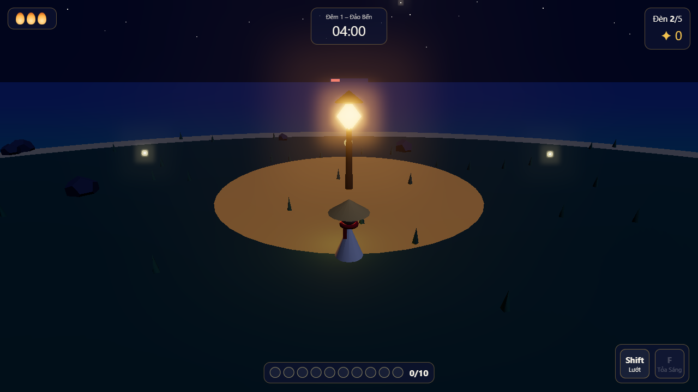
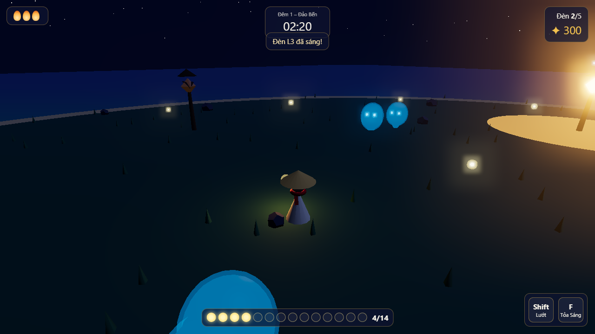
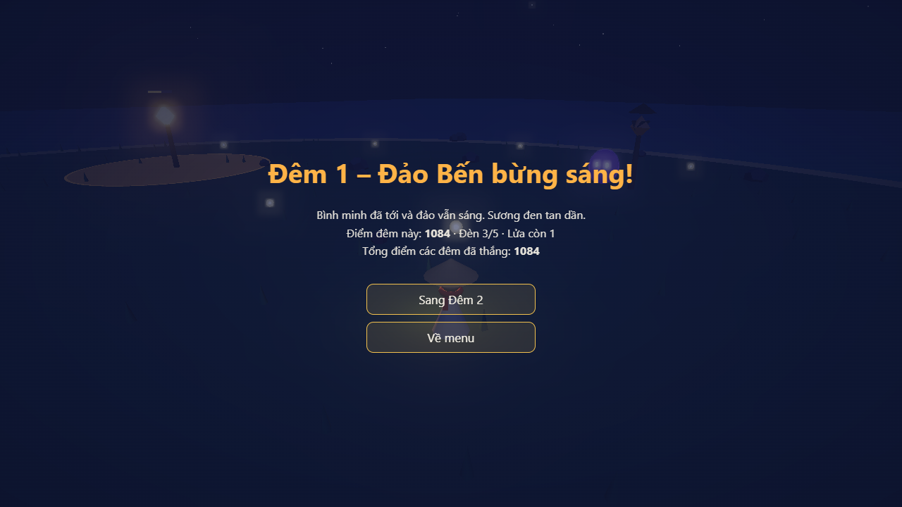

# Bằng chứng Phase 3 (tag `phase-3`)

Chạy lại: `npm test` (74 test + 28 scenario qua CLI thật, mỗi scenario chạy 2 lần để so tất định).
Sinh lại: `node scripts/proof.mjs phase-3` và `node scripts/browser-check.mjs docs/proof/phase-3/browser` (cần `npm start` đang chạy).

## Truy vết yêu cầu → bằng chứng
| Ticket-03 | Kiểm chứng | Bằng chứng | Kết quả |
|---|---|---|---|
| §1 Hao dầu 1/s, hết dầu → tắt, `deposited 0`, `ever_lit` | test + scenario | [p3-01](p3-01-fuel-out.jsonl) | Đạt |
| §1 Châm dầu `used = min(mang, ceil((100−fuel)/10))` | test + scenario | [p3-02](p3-02-refuel.jsonl) | Đạt |
| §1 Thắp lại bằng 5 (+40, `relight: true`) | test + scenario | [p3-03](p3-03-relight.jsonl) | Đạt |
| §1 Hiển thị thanh dầu, nhấp nháy 1 Hz < 30 | ảnh | [09](browser/09-low-fuel.png) | Đạt (ảnh) |
| §2 Ngưỡng 30, drain 5/s, `fuel_drain` mỗi 60 tick, cộng dồn | test + scenario | [p3-04](p3-04-drain.jsonl) | Đạt |
| §2 drain → chase / stunned (+15) / wander; hết choáng → wander | test + scenario | [p3-05](p3-05-pulse-drain.jsonl) | Đạt |
| §2 Châm lên ≥ 30 → đẩy bóng ra, không sát thương | test | `phase3.test.js` | Đạt |
| §3 Thắng bình minh (`dawn_survived`), thưởng | test + scenario | [p3-06](p3-06-dawn-win.jsonl): 450 điểm | Đạt |
| §3 Thua `dawn`; đèn tắt ở tick bình minh không tính | test + scenario | [p3-07](p3-07-dawn-lose.jsonl) | Đạt |
| §3 `no_flames` trước; ngưỡng 4/6, 5/7; không thắng sớm | test + scenario | [p1-03](p1-03-full-win.jsonl) (thắp đủ 5 → vẫn `playing`) | Đạt |
| §4 Sức chứa 10 + 2 × lần thắp, tối đa 20 | test + scenario | [p3-08](p3-08-capacity.jsonl) | Đạt |
| §5 Bảng điểm mới | test | các test trên | Đạt |
| §6 Chế độ mù màu | ảnh + chạy tay | [10](browser/10-colorblind.png) | Đạt (ảnh); lưu cài đặt kiểm tra tay |
| §7 Contract v1.2 | contract test | `tests/contract.test.js` | Đạt |
| DoD: ADR | — | [ADR 0001](../../adr/0001-lantern-fuel-and-dawn-win.md) | Có |
| DoD: changelog breaking changes | — | [CHANGELOG.md](../../../CHANGELOG.md) | Có |
| DoD: test cũ sửa/xóa có lý do | — | [phase-3.md §4](../../notes/phase-3.md) | Có, không skip |
| Hồi quy Phase 1–2 (phần không bị thay) | toàn bộ test cũ + scenario p1/p2 | `npm test` | Đạt |
| Hiệu năng | đo | 1 Đêm 21 600 tick: 0.44 s; FPS TB **42.7** (thấp nhất 39) ở 1280×720 — [fps.json](browser/fps.json) | Đạt |

Lỗi console khi chụp và đo: [browser/console-errors.json](browser/console-errors.json) (0). Thời gian từng scenario: [SUMMARY.md](SUMMARY.md).

## Ảnh mới của Phase 3
| Ảnh | Chứng minh |
|---|---|
|  | Đèn còn 25 dầu: thanh dầu đỏ (nhấp nháy 1 Hz), không còn vòng an toàn; HUD sức chứa `0/10` |
|  | Chế độ mù màu: Bóng Mực #00B3FF; đèn tắt bị xẹp và có giấy rách (bên trái); sức chứa `4/14` |
|  | Bình minh: `Đêm 1 – Đảo Bến bừng sáng!`, còn 3/5 đèn sáng → thắng (bot autoplay, seed 5) |
