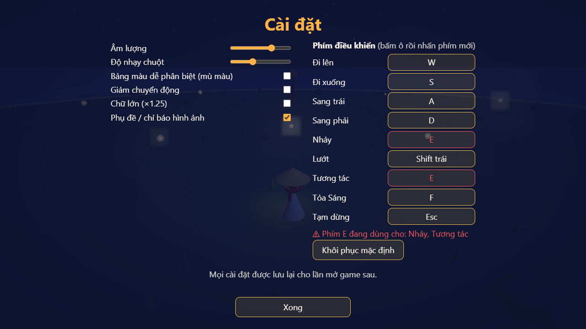
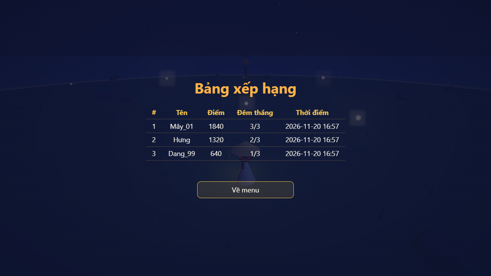
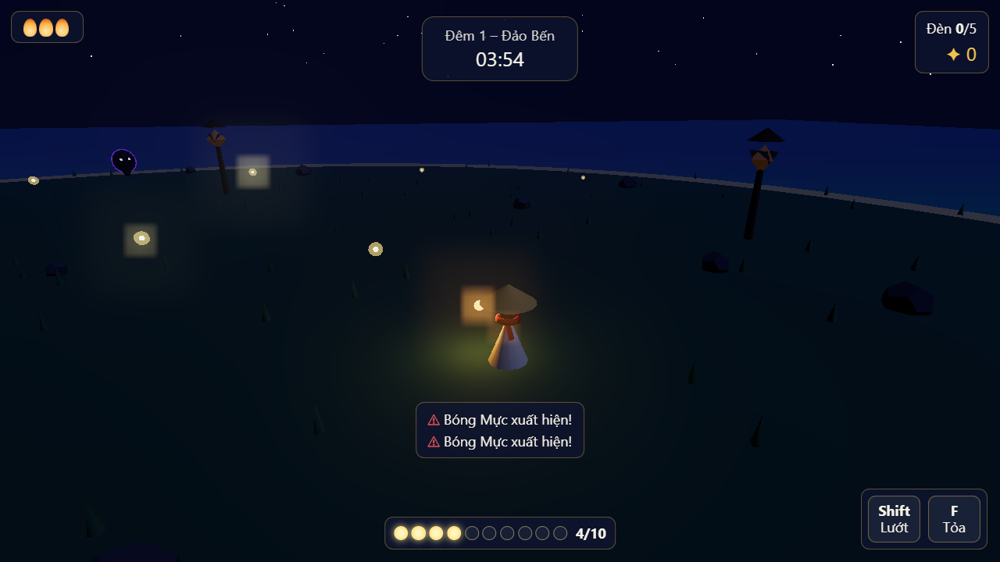
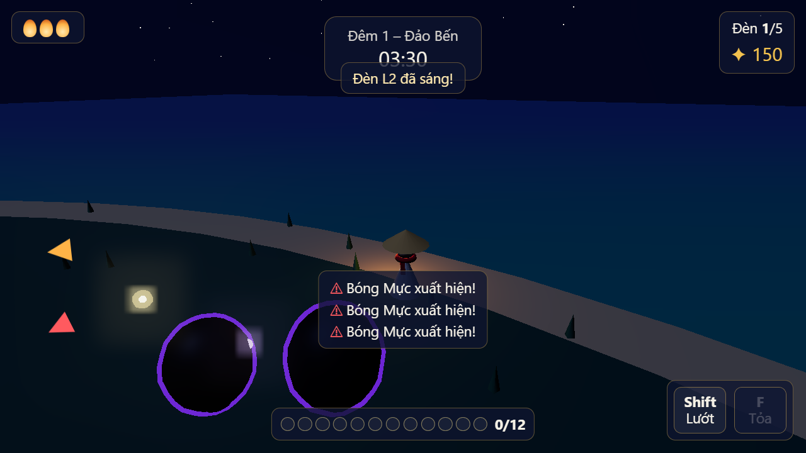
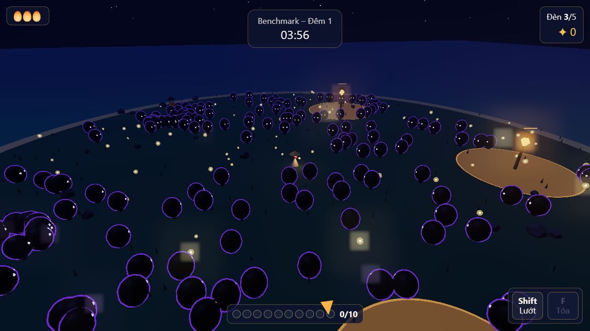

# Bằng chứng Phase 4 / v1.0.0 (tag `phase-4`)

## Số đo (chạy thật trên máy dev, file do lệnh sinh ra, không sửa tay)
**[bench.json](bench.json)** — `node scripts/bench.mjs --seed 42 --duration 30 --out bench.json` (cửa sổ Chrome 1280×720, vsync tắt)

| Chỉ số | Kết quả | Ngưỡng | |
|---|---|---|---|
| avg_fps | 66.4 | ≥ 60 | Đạt |
| p1_low_fps | 26.4 | ≥ 30 | **Chưa đạt trên máy dev** |
| frame_ms_p95 | 21.8 | — | |
| load_ms | 1617 | ≤ 10000 | Đạt |
| peak_mem_mb | 534 (tổng RSS các tiến trình Chrome) | — | |

Máy dev: Windows 11 · Intel i5-1135G7 (8 luồng) · Intel Iris Xe (GPU tích hợp, ANGLE D3D11) · 7.7 GB RAM · cắm sạc, chế độ nguồn Balanced · Chrome 157 · three.js r160.
Số chính thức đo trên máy chấm của giảng viên (Ticket-04 §1). Quá trình chẩn đoán và tối ưu: [docs/notes/phase-4.md §4](../../notes/phase-4.md).

**[soak.json](soak.json)** — `node --expose-gc --jitless --max-semi-space-size=1 src/soak.js --seed 7 --nights 10 --out soak.json`

| Chỉ số | Kết quả | Ngưỡng | |
|---|---|---|---|
| crashes | 0 | 0 | Đạt |
| mem_end / mem_start | 31.6 / 30.1 MB = **1.05×** | ≤ 1.2× | Đạt |
| heapUsed sau GC | 4.15 → 4.25 MB | — | không rò rỉ |

## Truy vết yêu cầu
| Ticket-04 | Bằng chứng | Kết quả |
|---|---|---|
| §1 bench: lệnh, cảnh chuẩn, trường JSON, công thức | `bench.json`, ảnh 16, test `frameStats` | Đạt (trừ p1 low trên máy dev) |
| §2 soak | `soak.json`, test soak (chạy 2 lần, kết quả giống nhau) | Đạt |
| §3 bảng xếp hạng + `--export-leaderboard` | 3 test, ảnh 13 | Đạt |
| §4 đổi phím + báo trùng + khôi phục | ảnh 12 | Đạt |
| §4 phụ đề, mũi tên Bóng Mực, gió, 10 s, đèn < 30 | ảnh 14 | Đạt |
| §4 giảm chuyển động, chữ ≥ 18 px, chữ lớn ×1.25 | ảnh 15, CSS `1em = 18px` | Đạt |
| §5 README / CHANGELOG / CREDITS / LICENSE | các file ở gốc repo | Đạt |
| §5 bản chạy được | `node scripts/package.mjs` → zip 2 MB; giải nén vào thư mục trống: headless OK, trình duyệt 0 lỗi console | Đạt (Release do người làm tạo) |
| §6 contract v1.3 | `tests/contract.test.js`, `tests/phase4.test.js` | Đạt |
| Hồi quy Phase 1–3 | `npm test`: 80/80 | Đạt |

Lỗi console khi chụp: [browser/console-errors.json](browser/console-errors.json) (0).

## Ảnh mới của Phase 4
| Ảnh | Chứng minh |
|---|---|
|  | Cài đặt: đổi phím (9 hành động), cảnh báo **phím E trùng** (Nhảy, Tương tác), Khôi phục mặc định, giảm chuyển động, chữ lớn, phụ đề |
|  | Bảng xếp hạng từ menu (tên tiếng Việt có dấu được chấp nhận) |
|  | Phụ đề "⚠ Bóng Mực xuất hiện!" lúc 2 con sinh ra ở giây thứ 5 |
|  | Chữ lớn ×1.25 |
|  | Cảnh bench: 200 Bóng Mực, 100 đom đóm, L1–L3 sáng, camera ở (30, 15, 0) nhìn về tâm |
